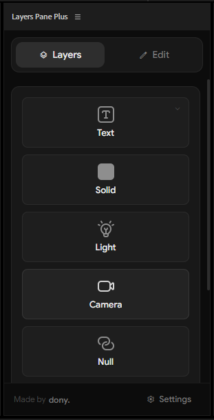
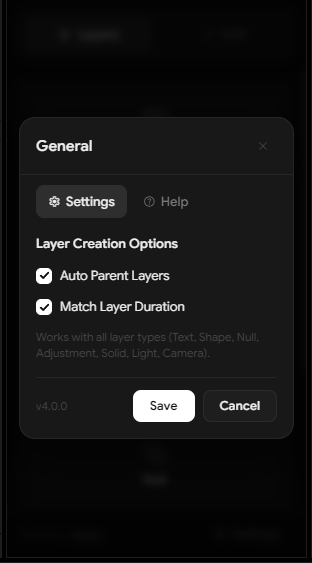

# Layers Pane Plus por dony.

[](README.md)
[](README_ES.md)
[](CHANGELOG_ES.md)
[](#compatibilidad)
[](#compatibilidad)
[](#stack-tecnológico)
[](LICENSE)

> **[Read in English](README.md) | Leer en Español**

<p align="center">
  
  &nbsp;&nbsp;
  
</p>

## Descripción
Layers Pane Plus es una extensión avanzada para Adobe After Effects que proporciona funcionalidad extendida para la creación y gestión de capas. Previamente distribuido como un script único, Layers Pane Plus ha evolucionado a una extensión CEP, ofreciendo una experiencia más robusta, moderna e integrada en After Effects.

## Versión Actual
**v4.1.1** - El texto y los iconos se ven bien con el panel instalado para todos los usuarios. Ver [CHANGELOG_ES.md](CHANGELOG_ES.md).

## Novedades en v4.1.1
- Instalado para todos los usuarios, en `C:\Program Files (x86)\Common Files\Adobe\CEP\extensions`, el panel mostraba cada icono con su nombre, como `layers`, y el texto en la fuente del sistema. Ahora carga sus fuentes también desde esa carpeta.

## Instalación

### Para usuarios: instalación rápida (recomendada)
Cada [release](https://github.com/dony-aep/layers-pane-plus/releases/latest) incluye un `.zxp` firmado. No necesita modo debug ni claves de registro.

1. Descarga e instala el [ZXP/UXP Installer de aescripts + aeplugins](https://aescripts.com/learn/zxp-installer/), gratuito, para Windows y macOS.
2. Descarga `layers-pane-plus-vX.Y.Z.zxp` de la última release.
3. Cierra After Effects y abre el `.zxp` en el instalador: arrástralo a la ventana o usa **File > Open**.
4. Abre After Effects y ve a **Ventana > Extensiones > Layers Pane Plus**.

> Si el instalador dice que no encontró ninguna aplicación compatible y marca After Effects con «Action required», es porque el instalador de Adobe necesita la app de escritorio de Creative Cloud abierta y con la sesión iniciada. Puedes instalar sin ella: pulsa **Install Anyway**. Si eso falla, abre los ajustes del instalador (icono del engranaje), activa **Install for current user only** e instala de nuevo.

> Si instalaste una versión anterior copiando la carpeta `com.donyaep.LayersPanePlus` en `C:\Program Files (x86)\Common Files\Adobe\CEP\extensions` (o en `/Library/Application Support/Adobe/CEP/extensions` en macOS), borra esa copia antes. El instalador pone la versión nueva en tu carpeta de usuario, y dos copias de la misma extensión pueden mezclar sus archivos.

### Para usuarios: instalación manual (zip)
1. Localiza la carpeta de extensiones CEP de After Effects:
   - **Windows:** `C:\Program Files (x86)\Common Files\Adobe\CEP\extensions` (o, por usuario: `%APPDATA%\Adobe\CEP\extensions`)
   - **macOS:** `/Library/Application Support/Adobe/CEP/extensions` (o, por usuario: `~/Library/Application Support/Adobe/CEP/extensions`)
2. Descomprime el zip de la release y copia en ese directorio la carpeta `com.donyaep.LayersPanePlus` que viene dentro.
3. Inicia After Effects y abre la extensión desde **Ventana > Extensiones > Layers Pane Plus**.

> Las builds sin firmar requieren activar el modo debug de CEP una vez. En Windows, haz doble clic en `Add Keys.reg`, que viene en el zip de la release, o ejecuta:
> ```
> reg add "HKCU\Software\Adobe\CSXS.11" /v PlayerDebugMode /t REG_SZ /d 1 /f
> ```
> En macOS, desde Terminal:
> ```
> defaults write com.adobe.CSXS.11 PlayerDebugMode 1 && killall cfprefsd
> ```

### Para desarrolladores (compilar desde el código fuente)
Requiere **Node.js 20.19+ o 22.12+** (requisito de Vite 8).

```bash
npm install        # instalar dependencias
npm run dev        # servidor de desarrollo de Vite (vista previa en navegador)
npm test           # tests unitarios (vitest)
npm run build      # chequeo de tipos + build de producción a dist/
npm run deploy     # build + copia a %APPDATA%\Adobe\CEP\extensions (instalación local)
npm run package    # build + zip de dist/ en releases/ para distribución
npm run sign       # build + .zxp firmado en releases/ (requiere ZXPSignCmd y un certificado)
```

Tras `npm run deploy`, reinicia After Effects para cargar el panel actualizado.

## Stack Tecnológico
- UI en **React 19** + **TypeScript**, compilada con **Vite** (`build.target: chrome88`).
- **react-aria-components** para controles accesibles y navegables por teclado.
- **CSS Modules** + tokens de diseño (sin Tailwind), tema monocromático "Studio Console".
- Fuentes/iconos empaquetados localmente (Google Sans + subset de Material Symbols) — offline, sin CDN.
- Lógica host en **ExtendScript** (`public/jsx/scripts.jsx`) conectada a la UI vía `CSInterface.evalScript`.

## Compatibilidad
| Requisito | Mínimo |
|---|---|
| After Effects | 2022 (22.0) |
| Runtime CEP | 11 (Chromium 88) |

> El piso es After Effects 22.0 porque la herramienta de Marcadores usa `Layer.id`, introducido en After Effects 22.0.

## Características Principales
- Creación rápida de varios tipos de capas: Texto, Sólido, Objeto Nulo, Forma, Cámara, Luz, Ajuste
- Eliminación de capas seleccionadas con opción de confirmación
- Creación de secuencias de capas basadas en el orden de selección con opción de orden inverso
- División de capas en el indicador de tiempo actual con opciones de dirección de recorte
- Precomposición de capas seleccionadas utilizando el diálogo nativo de After Effects
- Creación de nuevas composiciones utilizando el diálogo nativo de After Effects
- **Herramienta de Marcadores:** añade marcadores a la composición (auto-numerados, detecta huecos) o a la capa seleccionada, elimina todos los marcadores, y **detecta y reubica** los marcadores existentes — individualmente o en grupo — en frames con visualización de timecode
- Auto Emparentar Capas (Compatible con todos los tipos de capas)
- Igualar Duración de Capa (Compatible con todos los tipos de capas)
- Panel de ajustes para personalizar el comportamiento de la extensión
- Interfaz amigable con botones con iconos
- Panel acoplable en el espacio de trabajo
- Ventana redimensionable con alineación adaptativa de botones

## Opciones de Configuración
- Auto Emparentar Capas: Emparenta automáticamente las capas seleccionadas a las nuevas capas
- Igualar Duración de Capa: Las nuevas capas igualan la duración de las capas seleccionadas
- Auto Eliminar Partes Divididas: Opción para eliminar automáticamente las partes divididas
- Dirección de Recorte: Elige si deseas mantener el lado izquierdo o derecho al dividir con la opción de auto eliminar activada
- Mostrar Confirmación de Eliminación: Alternar diálogo de confirmación para eliminación de capas
- Orden de Secuencia Inverso: Crear secuencias de capas en orden inverso de selección

## Uso
1. Abre Adobe After Effects.
2. Ve a **Ventana > Extensiones > Layers Pane Plus**.
3. Usa los botones para crear diferentes tipos de capas o realizar acciones.
4. Accede al panel de Configuración para personalizar el comportamiento de la extensión.
5. Para secuenciar capas:
   - Selecciona las capas en el orden deseado.
   - Activa la opción "Orden Inverso" si es necesario.
   - Haz clic en el botón de secuencia.
   - La extensión detectará si las capas ya están secuenciadas y pedirá confirmación.
6. Para crear capas con emparentamiento o igualación de duración:
   - Habilita las opciones deseadas en el panel de Configuración.
   - Selecciona la(s) capa(s) objetivo - múltiples capas soportadas para todos los tipos de capas.
   - Crea una nueva capa de cualquier tipo (Texto, Forma, Objeto Nulo, Sólido, Luz, Cámara o Ajuste).
7. Para dividir capas:
   - Posiciona el indicador de tiempo.
   - Selecciona capas específicas o deja sin seleccionar para aplicar a todas.
   - Haz clic en el botón de división.
   - Cuando "Auto Eliminar Partes Divididas" está activado, usa los botones de radio "Dirección de Recorte" para elegir si deseas mantener el lado izquierdo o derecho de la división.
8. Para precomponer:
   - Selecciona las capas a precomponer.
   - Haz clic en el botón de precomposición.
   - Utiliza el diálogo nativo de After Effects.
9. Para Ajustes de Capa:
   - Selecciona solo UNA capa (la extensión advertirá si se seleccionan múltiples capas).
   - Haz clic en el botón Ajustes de Capa.
10. Para Marcadores:
   - Elige el objetivo (Comp o Capa) con los botones de radio.
   - Haz clic en **Markers** para añadir un marcador en el tiempo actual (los de composición se auto-numeran y reutilizan huecos; los de capa requieren una sola capa seleccionada).
   - Usa **Remove all** para eliminar los marcadores del objetivo.
   - Abre **Detect markers** para listar los marcadores existentes y moverlos por frame — uno a uno o todos juntos conservando su espaciado.

## Historial de Versiones

Para el historial detallado de versiones y registro de cambios, consulta [CHANGELOG_ES.md](CHANGELOG_ES.md).

## Soporte
Si necesitas ayuda o quieres proporcionar retroalimentación, puedes contactarme aquí:
[https://linktr.ee/Dony.ae](https://linktr.ee/Dony.ae)

¡Disfruta esta extensión y feliz creación!